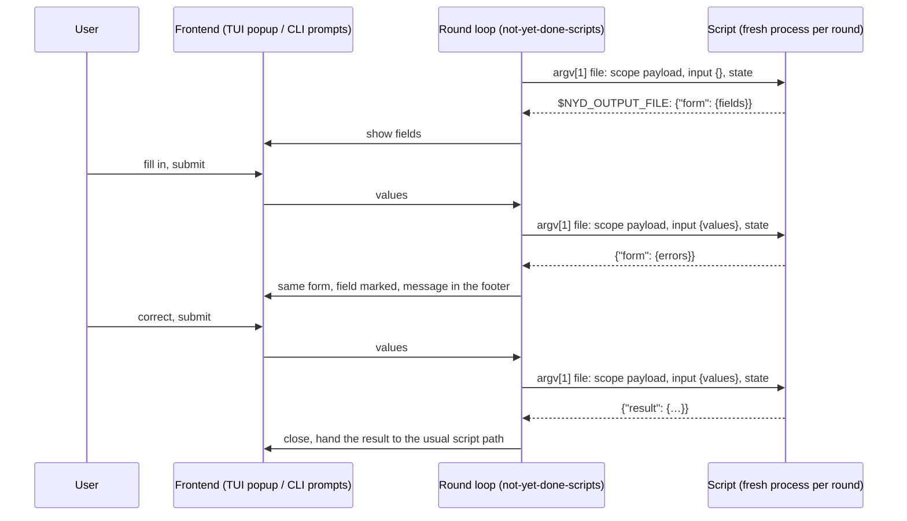

# Script-Driven Forms — Plan

Status: **design agreed (2026-09-22), nothing built.** Every decision below was
settled point by point with the user; the open work is the phases at the end.

## Goal

A view script may **ask the user for structured input**, validate the answers
itself, and — when something is wrong — say so _per field_ and ask again,
until the input is valid or the user gives up.

Two things make this worth building rather than faking with a prompt:

- **The script owns the rules.** Whether a date may lie in the future, whether
  a sprint is still open, whether two fields contradict each other — only the
  script knows, and often only after asking a backend. A declarative
  `required: true` cannot express any of it.
- **The answer is a conversation, not a form submission.** Rejecting input
  without losing what was typed is the whole point; today a script either takes
  what it gets or fails.

## What already exists

Nothing here starts from zero, and the plan deliberately extends the existing
pieces instead of putting a second mechanism beside them.

- **The form widget** — `not-yet-done-ratatui/src/widgets/form/`. `Form::new`,
  `handle_key`, `values()`, `render`; kinds `Text` (with `masked`), `Select`,
  `Toggle`, `DateTime { with_time }`; per field `required`, `default`,
  `visible_when`. Three consumers today: node-action forms, the login popup,
  the query-variable popup.
- **The protocol mirror** — `not-yet-done-content` carries its own
  `FormFieldSpec` / `FormFieldKind` / `FieldCondition`, `InputSpec::Form`,
  `ActionInput::Form`.
- **The round protocol** — `not-yet-done-content/src/auth/credential_script.rs`
  (see `plan-credential-script.md`) already runs a script in rounds: one fresh
  process per round, an answer that is _exactly one_ of `result` | `form` |
  `error`, and a request that carries every answer collected so far because the
  script cannot remember anything. This is the protocol that gets generalised.
- **The retry seam** — the TUI already keeps a form popup open on an adapter
  error, keeps the typed values, and shows the message underneath. What it
  cannot do is attach a message to a _field_.

## The marker: `# mode: form`

A form script is marked by a header line, not by its file name:

```python
# mode: form
```

`script_header_value()` (`not-yet-done-tui/src/app/editor.rs`) already reads the
first ten lines and accepts `#`, `//`, `--` and `;;`, so every script language
in use is covered. `ScriptMode` gains a seventh value next to `background`,
`capture`, `interactive`, `interactive+capture`, `commands` and
`interactive+commands`.

A naming convention such as `*.form.py` was rejected: it puts a second,
competing truth next to the header (what wins for `# mode: interactive` in
`report.form.py`?), it collides with the extension that decides language and
syntax highlighting, and switching a script back and forth would mean renaming
the file — which breaks every shortcut and hook keyed by script name.

## Protocol

One process per round, exactly as for credentials. The **transport** is the one
view scripts already use, not the credential one:

- **Request** — JSON written to a temp file whose path is the script's
  `argv[1]`. Nothing is piped to stdin.
- **Answer** — JSON written by the script to `$NYD_OUTPUT_FILE`.

stdout stays free on purpose: it is where a script author's `print()`, a
library warning or a stray `set -x` lands, and under `pause_tui` it belongs to
the user's terminal anyway.

### Request

The usual `scope:` payload (`node`, `filtered_set` or `table`), plus:

```json
{
  "node": { "…": "…" },
  "input": { "title": "Rework the exporter", "hours": "1.5" },
  "state": { "sprints": ["S-41", "S-42"] }
}
```

- `input` is `{}` in the first round and thereafter carries **every** value
  collected so far — the script is a fresh process and remembers nothing.
- `state` is whatever the script returned last round. The engine never looks
  inside it; it exists so a script can cache its own lookups (the sprint list)
  instead of fetching them again every round.

### Answer

Exactly one of three keys, counted on parse, with unknown fields rejected so a
typo fails loudly instead of being ignored:

```json
{ "form": { "header": "New work item", "fields": [ … ], "errors": [ … ] } }
{ "result": { "commands": [ … ] } }
{ "error": "Jira is not reachable" }
```

- **`form`** shows the form. It is _both_ the first round ("here are my
  fields") and every repetition after a validation failure ("here they are
  again, with these errors") — invalid input and asking again are one act, not
  two.
- **`result`** ends the conversation. Inside it sits the ordinary script answer,
  unchanged — `commands`, captured text, and so on. Success is expressed by
  _which key was used_, not by a boolean that could contradict the payload.
- **`error`** aborts with a message, without another round.

**Omitting `fields` in a later round keeps the form that is on screen** and
changes only the errors; sending `fields` replaces the form (to reveal a field
that only makes sense after the first answer). Either way the **values survive,
matched by field key**: a field that still exists keeps what the user typed,
one that disappears is dropped, a new one starts at its `default`. A `prefill`
sent by the script overrides that — the script wins when it says so.

### Errors

```json
"errors": [
  { "name": "birthday", "error": "must not be in the future" },
  { "error": "the tracker rejected the whole request" }
]
```

An entry **with** `name` hangs on that field, one **without** is the general
message. An unknown field name (a typo in the script) is not swallowed: it is
promoted to the general error and logged.

How they are shown:

- the field is marked — label and frame in the theme's error colour, never a
  hard-coded one,
- the **text** appears in the footer for the focused field, so no extra line
  per field and no jumping layout,
- a footer line too long to fit is truncated with an ellipsis and written out
  in full while its field is focused, visually overlapping whatever sits below
  if it has to.

A field error disappears as soon as **that field** is edited — the value it
referred to no longer exists. The general error stands until the next round
replaces it.

The editor-only `ActionOutcome::Reopen` gains a form counterpart,
`ReopenForm { errors }`, so adapters (Jira, Taiga, logins) can use the same
mechanism instead of collapsing everything into one sentence.

## Field types

Script-facing `type:` values and their widgets:

| `type:`             | Widget                                   | State        |
| ------------------- | ---------------------------------------- | ------------ |
| `text`              | `TextInput` (`masked` for secrets)       | exists       |
| `select`            | `MultiChoice` / `SelectList`             | exists       |
| `toggle`            | `Toggle`                                 | exists       |
| `date` / `datetime` | `DateTime { with_time }`, natural-date   | exists       |
| `number`            | integer, `min` / `max` / `step`          | **to build** |
| `decimal`           | floating point, `min` / `max`, precision | **to build** |
| `duration`          | `1:30`, `90m`, `1h30` → normalised       | **to build** |
| `multiline`         | fixed-height scrolling text area         | **to build** |
| `multiselect`       | several options at once                  | **to build** |
| `file`              | file picker inside the form              | **to build** |

Orthogonal to the type, as today: `required`, `default`, `masked`,
`visible_when`.

Notes that shaped the list:

- Gaps that are only about **checking** a value (range, format, mutually
  exclusive fields) would not need a type at all — the rounds cover them, and
  the script knows the rules better than any widget. The new types are there
  for comfort and immediate feedback.
- Gaps that are a different **input gesture** (multi-line, multi-select, file)
  cannot be validated away, which is why they are built.
- **`decimal` accepts only the dot**, with the separator configurable in
  `tui.yaml`. That setting governs input and display; the value handed to the
  script stays canonical with a dot, so no script depends on the configuration
  of whoever runs it.
- **`multiline` stays small**: a fixed number of scrolling lines, no Vim
  bindings — that is `InputSpec::Editor`, a different thing. `Enter` inserts a
  newline, so such a form is submitted with the submit key only.
- An unknown `type:` is a loud error, never a silent fallback to `text`.

## Rounds vs. `visible_when`

Both can change what the form shows, and both stay:

- **Decidable from values already in the form** → `visible_when`. It is
  re-evaluated on every keystroke and costs nothing; building it out of rounds
  would mean one process per keystroke.
- **Needs knowledge only the script can fetch** → a new round with a new
  `fields` list. It costs a process and a visible pause, and buys a backend
  question.

## Ending a conversation

- **No round limit.** The user can always press `Esc`, and every round needs a
  submit, so nothing can spin unattended. The one real hole is a `form` with
  **no fields** — instantly submittable, hence a loop without a human brake —
  so that is a loud error. After roughly fifty rounds a line goes to the log,
  purely for diagnosis.
- **`Esc` only cancels outright while nothing has been entered** (no value
  differs from its `default` / `prefill`; moving the focus around does not
  count). Otherwise a `Discard your input?` prompt appears, defaulting to
  **no**: `y` discards, `n` and `Esc` return to the form, so `Esc Esc` never
  throws work away. This lives in the form widget, so all forms behave alike —
  including the login and query-variable popups, where `Esc` cancels
  immediately today.
- Cancelling does **not** start the script again. Each round is a process that
  has long since exited; there is nothing to tear down. Scripts write in the
  `result` step, not before.

## Layering

Today `not-yet-done-scripts` owns **where** scripts live and says in its own
crate documentation that it deliberately knows nothing about **how** they run —
that stays with the embedder, the TUI. Running form scripts from the CLI breaks
that: the CLI would have to rebuild payload files, `$NYD_OUTPUT_FILE` and the
round loop beside the TUI's copy. So the boundary moves from "where" to "where
and how".

| Crate                                   | Owns                                                                                                  |
| --------------------------------------- | ----------------------------------------------------------------------------------------------------- |
| `not-yet-done-content`                  | types and pure logic: field spec, round answer, round parsing, form state across rounds, `ReopenForm` |
| `not-yet-done-scripts`                  | execution: payload file, process start, `$NYD_OUTPUT_FILE`, the round loop, reading `# mode:`         |
| `not-yet-done-ratatui`                  | the widgets: new field types, field-error rendering, the discard prompt                               |
| `not-yet-done-tui` / `not-yet-done-cli` | presentation only: popup here, `fieldsmith` prompts there                                             |

Execution goes to `not-yet-done-scripts` rather than `not-yet-done-content`
because that crate already owns the script domain and already depends on both
`not-yet-done-content` and `fieldsmith`, while `content` is the _adapter_
protocol crate. (`credential_script.rs` living in `content` is no
counter-example: authentication is adapter business.)

Two things to be disciplined about:

1. **Only the kernel leaves `app/script.rs`** (1751 lines) — build the payload,
   start the process, read the output, parse the round. Menu, panes,
   `pause_tui`, editor handover, `commands` dispatch and pane reload stay in
   the TUI. Otherwise half the TUI ends up in a library.
2. **Only the _parsing_ of `# mode:` moves.** Every mode hangs off
   `ScriptMode`; moving the parse (a pure function) is safe, moving the
   per-mode handling is not.



## Frontends

- **TUI** — the form popup, as today, plus field errors and the discard prompt.
- **CLI** — `nyd script run <name>` drives the same rounds through `fieldsmith`
  (workspace member, `stdin` feature over `dialoguer`, already behind the
  `config build` wizard). This is not a luxury: it is how a form script gets
  developed and tested without navigating the TUI, and how one gets automated.
  - `--set field=value` supplies values from outside; whatever is still missing
    is prompted for, and a fully supplied form runs without asking.
  - **Without a TTY nothing waits**: a missing field in a cron job aborts
    loudly and names the field.
  - `text`, `select`, `toggle`, `multiselect` and masked fields map onto ready
    `dialoguer` prompts; `number`, `decimal`, `duration` and `date` become text
    inputs with the same checks as in the TUI; `multiline` has no usable
    `dialoguer` equivalent and opens `$EDITOR`; `visible_when` means the field
    is skipped.

## Testing

Four levels, pushed as far down as they will go:

1. **Round parsing** — a pure `text → round` function, as in
   `credential_script.rs` (which has fourteen tests precisely because parsing is
   separate from running). Cases: each of the three keys, two keys at once,
   none, an unknown field, an unknown `type:`, a `form` without fields.
2. **Form state across rounds** — a pure function from (previous form, current
   values, new answer) to (next form, errors, carried values). Every rule in
   this document about keeping values, replacing fields, clearing errors and
   promoting unknown field names lives here, testable without a widget, a
   process or a terminal.
3. **Rendering** — `TestBackend` buffer assertions, already house style here
   (twelve files; `not-yet-done-ratatui/tests/form.rs` checks masked bullets and
   panel padding that way). The buffer yields both symbols and per-cell style,
   so the truncated error line, its expansion on focus and the theme error
   colour are all assertable in `cargo test`.
4. **The whole chain** — driving the real TUI: script menu, process start,
   payload file, form, rounds, `$NYD_OUTPUT_FILE`, result in the pane, with the
   real theme and a real terminal. Its script is a chapter in `smoke-tests.md`,
   written while building rather than afterwards.

## Phases

1. **Protocol core** (`not-yet-done-content`) — round types, `parse_round`, the
   form-state function, the extended field spec, `ActionOutcome::ReopenForm`.
   Tests at levels 1 and 2.
2. **Execution** (`not-yet-done-scripts`) — payload file, process start,
   `$NYD_OUTPUT_FILE`, round loop, `# mode:` parsing moved out of
   `app/editor.rs`; the kernel carved out of `app/script.rs`. Crate
   documentation rewritten to the new boundary.
3. **Widgets** (`not-yet-done-ratatui`) — field errors (marking, footer text,
   ellipsis and its expansion), the discard prompt, then the new field types:
   `number`, `decimal`, `duration`, `multiline`, `multiselect`, `file`. Tests
   at level 3.
4. **TUI** — form scripts in the script menu and on chords, popup wired to the
   round loop, `ReopenForm` used by the existing form consumers.
5. **CLI** — `nyd script run`, `--set`, the `fieldsmith` renderer, the no-TTY
   abort.
6. **Docs and smokes** — `generic-view-spec.md` (script actions, field types,
   the round protocol), README, an example form script, and the smoke chapter,
   which is then actually driven.
